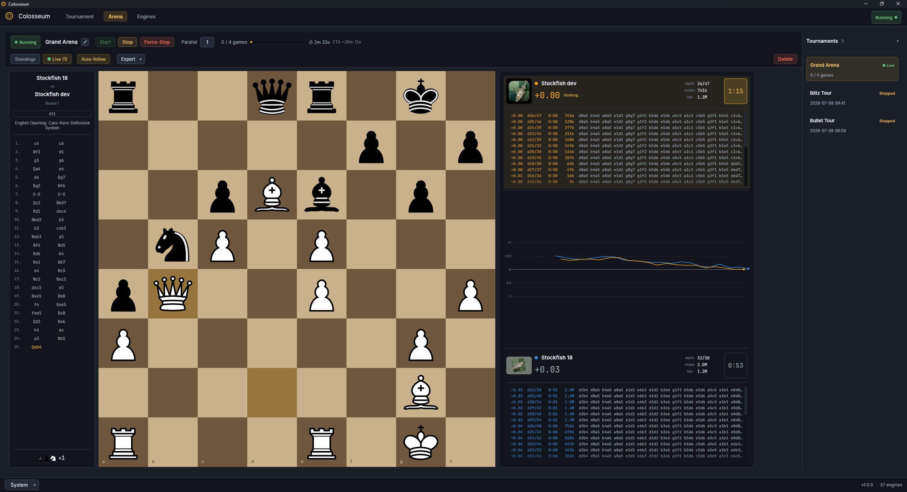

<p align="center">
  
</p>

<h1 align="center">Colosseum</h1>

<p align="center">
  Run and watch tournaments between UCI chess engines.
</p>

> **Windows · Linux · macOS · GPL-3.0-or-later**

Colosseum is a desktop application. It plays many games at once and shows
them live, keeps a library of your engines with their options, runs round
robins and gauntlets, rates the engines with error bars, keeps every finished
game, and resumes an interrupted tournament. It works with any ordinary
[UCI](https://www.shredderchess.com/chess-info/features/uci-universal-chess-interface.html)
engine; no manifest or source access is needed.

Looking for the command-line tool? [Colosseum CLI](https://github.com/maelic13/colosseum-cli)
is a separate program for engine developers: it plays matches and
tournaments in a terminal or a script, tells you with SPRT whether a
change made an engine stronger, tunes parameters and measures speed.



## Install

Pick the newest entry on the [release list](https://github.com/maelic13/colosseum/releases)
and download the file for your machine.

| Platform | File | How to install |
|---|---|---|
| Windows, Intel or AMD | `colosseum-gui-…-windows-x64.msi` | Double-click and follow the installer |
| Windows, Arm (Snapdragon) | `colosseum-gui-…-windows-arm64.msi` | Double-click and follow the installer |
| Windows, no installer | `colosseum-gui-…-windows-….zip` | Unzip and run `colosseum.exe` |
| Ubuntu, Debian, Mint, Pop!_OS | `colosseum-gui-…-linux-x64.deb` | `sudo apt install ./colosseum-gui-….deb` |
| Fedora, RHEL, openSUSE | `colosseum-gui-…-linux-x64.rpm` | `sudo dnf install ./colosseum-gui-….rpm` |
| Arch, CachyOS, EndeavourOS, Manjaro | `colosseum-gui-…-linux-x64.pkg.tar.zst` | `sudo pacman -U ./colosseum-gui-….pkg.tar.zst` |
| Other Linux | `colosseum-gui-…-linux-x64.tar.gz` | Extract and run `./colosseum` |
| macOS, Apple Silicon | `colosseum-gui-…-macos-arm64.dmg` | Open and drag Colosseum to Applications |

Intel Macs are not supported. The macOS app is not signed, so the first launch
is blocked: open **System Settings → Privacy & Security** and click
**Open Anyway**.

**Using 1.1.0?** It does not notice newer releases. Download the newest one
by hand once; from then on Colosseum tells you about updates itself.

To check a download arrived intact, compare its SHA-256 with the digest GitHub
shows beside that asset on the release page:

```text
Get-FileHash colosseum-gui-1.2.0-windows-x64.msi
sha256sum colosseum-gui-1.2.0-linux-x64.deb
shasum -a 256 colosseum-gui-1.2.0-macos-arm64.dmg
```

The three lines are Windows, Linux and macOS respectively.

## First tournament

1. **Engines tab** — *Add Engine* and pick an executable, or *Scan Folder* to
   add many at once. Set a starting Elo if you know one.
2. **Tournament tab** — tick the engines, choose a format and a time control,
   press *Start Tournament*.
3. **Arena tab** — watch the standings fill, or switch to *Live* to follow a
   game move by move.

Tips:

- Keep **Parallel games** at or below your CPU core count. Engines that share
  a core lose on time.
- **Update ratings** decides whose library Elo the tournament changes. Testing
  one new engine? Choose *Chosen engines* and pick only that one.
- Stopped a tournament? Select it in the Arena list and press *Start*; it
  continues where it left off.
- A game whose engine could not be started at all is shown as aborted and
  not scored. An engine that starts and then crashes, plays an illegal move
  or runs out of time loses that game.

## Where Colosseum keeps its files

| | Windows | Linux | macOS |
|---|---|---|---|
| Settings and engine library | `%APPDATA%\Colosseum\` | `~/.config/colosseum/` | `~/Library/Application Support/Colosseum/` |
| Games and logs | `%APPDATA%\Colosseum\` | `~/.local/share/colosseum/` | `~/Library/Application Support/Colosseum/` |

Start Colosseum with `--portable` to keep everything next to the program.
`colosseum --version` prints the installed version.

## What changed

See the [changelog](legacy/CHANGELOG.md). Colosseum 2.0, a new version of
the application, is in development in this repository.

## Building from source

The current application is in `legacy/`, a Rust workspace:

```text
cd legacy
cargo build --release -p colosseum-gui
```

On Linux it needs the GTK 3 and XCB development headers.

## License

[GPL-3.0-or-later](LICENSE).
